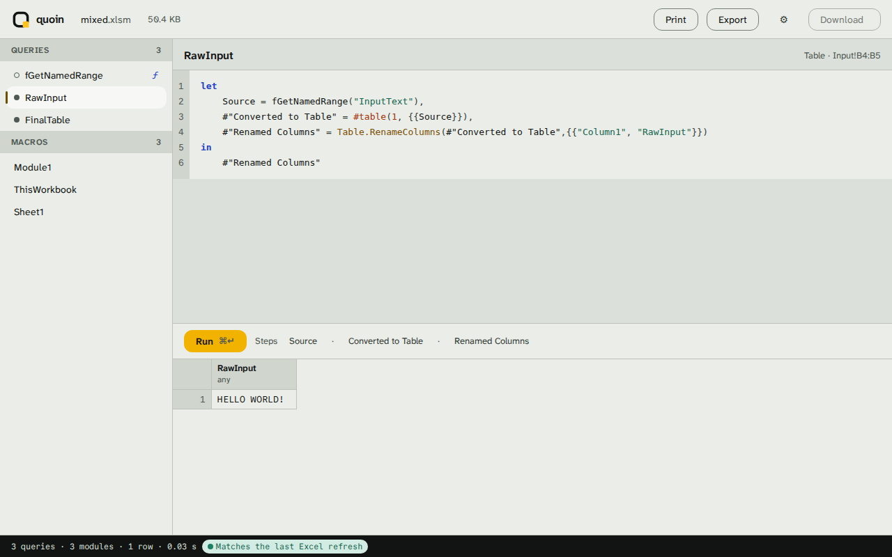

# Quoin

The working parts of a workbook.

Quoin opens an Excel `.xlsx` or `.xlsm` file in your browser and shows its Power Query queries and VBA macros. You can edit them, run the queries, compare the result with what Excel last loaded, and download a workbook that differs from the original only in the parts you changed.



**Try it:** https://power-query-manager.vercel.app · **Sample file:** [`examples/mixed.xlsm`](examples/mixed.xlsm) (three queries, three VBA modules)

## What it does

**Read**
- Lists every Power Query query in the workbook. Functions carry an ƒ badge, and each query shows where it loads: a table, the data model, or connection only.
- Lists every VBA module (standard modules, classes, and the workbook and sheet modules).
- Shows file details: format, size, number of queries, modules, sheets and tables.

**Edit**
- A code editor for M and VBA with line numbers, syntax highlighting and find (next, previous, match case).
- Marks edited items, lets you revert each one or everything at once (after a confirmation that names the count), and warns before you leave or open another file with unsaved edits.
- Download stays disabled until something is edited, then shows the number of changes. *Review changes* lists each changed query or macro as a unified diff.
- Blocks a download whose macro text cannot be saved (a character outside the project's code page, a line over 1,023 characters, a typed `Attribute` line) and says which line and why.
- Downloads the workbook with only your edits applied. Where the browser offers a file picker, quoin writes through it, reads the file back and compares it byte for byte before it says the file was saved; elsewhere it downloads the file and says only that. Queries you edited are set to refresh when Excel opens the file, unless you turn that off.

**Run**
- Runs queries in a worker with a purpose-built M interpreter: lexer, parser, lazy evaluator and a library of 545 entries (511 full, 2 partial, 32 unsupported). The list is in [`docs/m-coverage.md`](docs/m-coverage.md).
- Shows the result as a grid, with the steps listed above it. You can sort, drill into records, lists and tables, and copy column names. Sorting is limited to 200,000 rows.
- Runs have a time limit and a row cap, and can be cancelled. The culture used for dates and numbers is a setting.
- `Excel.CurrentWorkbook` reads the open workbook. `File.Contents` and `Web.Contents` stop the run and ask you to choose a local file.

**Compare**
- Checks each result against the table Excel last loaded for that query. It reports a row count mismatch, differing columns, or the number of differing cells, and highlights them.
- Queries that depend on the clock or on random numbers are marked and are not compared.
- *View differences* lists the first 200 differing cells with the Excel value and quoin's value. quoin's engine is not Excel's, so a difference is information, not a failure.

**Export**
- Result: CSV (UTF-8, or UTF-8 with BOM for Excel), TSV, JSON records, or a new `.xlsx`. A guard against formula injection in CSV is on by default.
- Code: one query as `.m`, all queries as a zip of `.m` files, one module as `.bas` or `.cls`, all modules as a zip, or everything as one zip.

**Print**
- A print preview with paper (A4, A3, Letter, Legal, Tabloid, Executive), orientation, margins, rows per page, scale, a repeated header, repeated first and last rows, column choice and bands for wide tables, a running head and `Page N of M`, and a choice of result, code, code and result, or the changes as a diff. quoin builds the pages itself, so repeated bottom rows and page numbers work in every browser.
- What a browser cannot do while printing (printer, tray, duplex, the paper picked in the dialog, the page count) is listed in [`docs/observations.md`](docs/observations.md). Use Save as PDF in the print dialog for a PDF.

**Around it**
- Light, dark and system themes. Keyboard shortcuts, with a help sheet (`?`), including open, save, run, print, find and stepping through matches.
- Installable, and cached for offline use by a service worker.
- Accessibility checks with axe-core run in the test suite.

## What it does not do

- It never runs VBA. VBA is shown and edited only.
- It makes no network requests after load. Database and web connectors stop with an error that names the function, and the 32 unsupported library entries do the same.
- It does not read the data model (`xl/model`).
- It opens `.xlsx`, `.xlsm`, `.xltx` and `.xltm`. It refuses `.xls`, `.xlsb`, OpenDocument, Strict Open XML and password-protected workbooks, each with a specific message.
- A VBA project that is locked for viewing, uses an unsupported code page, or does not parse cleanly is shown read-only. Editing a signed project removes its signature, after you confirm.
- It has not been run against real Excel. The checks that need Excel are listed in [`docs/observations.md`](docs/observations.md), and none has been run. Opening an edited file in Excel is the step still to confirm.
- Only Chromium has been tested. Firefox and WebKit have not been run.

## Privacy

Your file never leaves the tab. Quoin makes no network requests after the page and its assets load, sets a Content Security Policy that forbids them, and stores one thing: your theme choice, under the key `quoin.theme` in local storage. There are no cookies, no analytics, and no databases.

## Built with

- **No runtime dependencies.** Plain ES modules, no framework and no bundler. `npm run build` only refreshes `asset-manifest.json` for the service worker.
- **Written from scratch:** the ZIP reader and writer, an XML scanner that records byte spans so edits are text splices, the Open Packaging Conventions layer, a compound file (CFB) reader and writer, OVBA compression, the DataMashup reader and writer, and the M lexer, parser and evaluator. The reasons are in [`docs/decisions.md`](docs/decisions.md).
- **Browser features:** `CompressionStream` and `DecompressionStream`, module workers, `<dialog>`, and a service worker.
- **Fonts:** Atkinson Hyperlegible Next and Commit Mono, self-hosted, under the SIL Open Font License. The licence texts are in `public/fonts/`.
- **Development only:** Playwright 1.56.0 for browser tests, axe-core for accessibility checks, acorn for the lint checks.

## How it works

The file is opened as a ZIP in memory. Power Query lives in a `DataMashup` binary and VBA in a `vbaProject.bin` compound file. Both are parsed, shown, and rewritten in place. Untouched parts are copied as their original compressed bytes. After writing, Quoin reads its own output back and checks every edit and every untouched part before offering the download. If the check fails, nothing is downloaded.

Queries run in a worker. An interpreter that cannot wait for a file stops with a signal, the page asks you for the file, and the run starts again with the file in place. Time values hold 100 ns ticks as `BigInt`.

Limits against hostile files are in `src/core/limits.js`: archives with more than 20,000 entries, more than 1 GB inflated, an implausible compression ratio, or a file over 200 MB are refused, as is XML that declares a DOCTYPE or entities.

The full specification is [`docs/QUOIN_SPEC.md`](docs/QUOIN_SPEC.md). Where the build differs from it, [`docs/decisions.md`](docs/decisions.md) says why.

## Run locally

```
npm install
npm run serve
```

Then open `http://localhost:5173`. The app needs an origin because it uses a module worker and a service worker, so opening `index.html` from `file://` does not work.

To deploy, see [`docs/deploying.md`](docs/deploying.md).

## Tests

```
npm test             lint, unit, and browser tests
npm run test:unit    node --test, no browser needed
npm run test:lint    no comments, no remote imports, tokens-only CSS, strings rules
npm run test:browser Playwright (Chromium)
npm run fixtures     regenerate the synthetic fixtures
node scripts/make-icons.mjs   regenerate the PNG icons from the SVG sources
```

Visual baselines are in `tests/__visual__` (Chromium on Linux). After a deliberate change to the look, run `npx playwright test tests/e2e/visual.spec.js --update-snapshots` and look at the new images before committing them.

To add a fixture, put the workbook under `tests/fixtures/` and describe where it came from in `tests/fixtures/workbooks/README.md`. Prefer workbooks saved by real Excel.

## Layout

```
index.html, sw.js, manifest.webmanifest, _headers
src/core        pure logic: zip, xml, opc, cfb, ovba, power query, m engine, exports, diff, print layout
src/ui          editor, grid, dialogs, strings
src/app         session, workspace, runner, main
src/workers     the M worker
styles          tokens, component styles and print.css
tests           unit, e2e, a11y, lint, fixtures
docs            the spec, decisions, observations, generated M coverage, deploying
examples        a sample workbook
```
